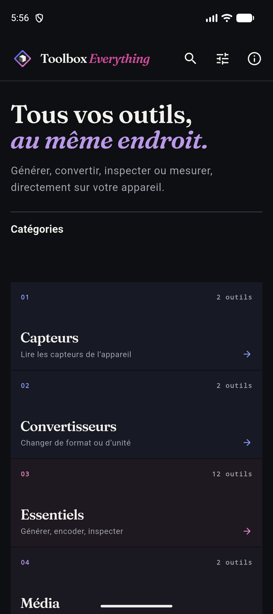
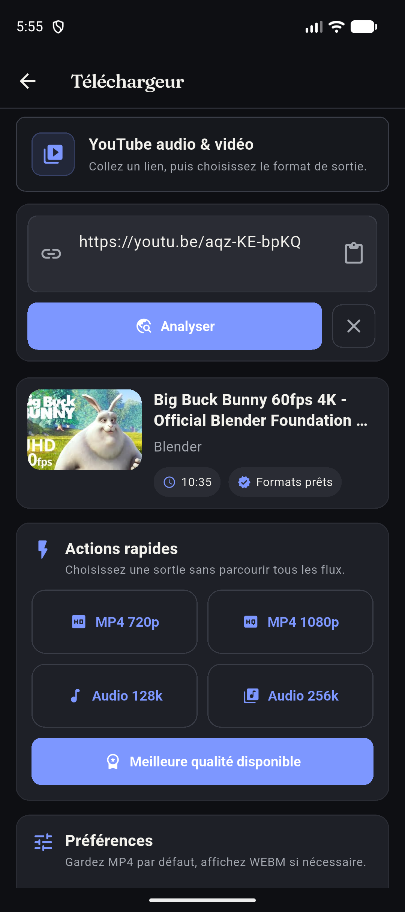
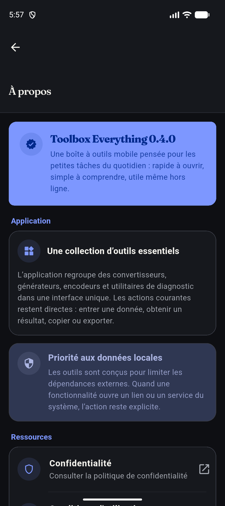

# Toolbox Everything Mobile

[](https://github.com/Doalou/toolbox_everything_mobile/actions/workflows/android.yml)
[](https://github.com/Doalou/toolbox_everything_mobile/actions/workflows/ios.yml)


La boîte à outils locale pour Android et iOS : générer, convertir, inspecter et
mesurer sans compte ni backend.

La majorité des fonctions travaillent directement sur l’appareil. Seuls le
téléchargeur et le diagnostic réseau contactent des services externes.

<p align="center">
  
  
  
</p>

## Points clés

- **21 outils** réunis dans un catalogue recherchable et organisé par atelier.
- **Local-first** pour les générateurs, convertisseurs, notes et capteurs.
- Thèmes clair, sombre, système et AMOLED.
- Identité éditoriale partagée avec
  [Toolbox Everything Web](https://github.com/Doalou/toolbox_everything).
- Palette de marque par défaut, avec accent ou couleurs Material You en option
  avancée.
- Aucun compte utilisateur et aucune télémétrie applicative.

## Outils

| Atelier | Outils | Réseau requis |
|---|---|:---:|
| Essentiels | Mots de passe, QR Code, hash, encodeur/décodeur, JSON, UUID, timestamp, JWT, regex, diff, Lorem Ipsum, couleurs | Non, sauf scan caméra |
| Convertisseurs | Unités, binaire/hexadécimal/décimal/texte | Non |
| Capteurs | Boussole, niveau à bulle | Non |
| Média | Conversion de fichiers, téléchargement audio/vidéo | Téléchargeur uniquement |
| Réseau | Type de connexion, IP publique, latence et débit indicatif | Oui |
| Productivité | Notes locales, minuteur et chronomètre | Non |

Les fonctions disponibles dans une release peuvent être contrôlées dans
`lib/core/feature_flags/app_feature_flags.dart` afin de respecter les
contraintes des stores.

## Plateformes

| Plateforme | Minimum | Validation CI |
|---|---:|:---:|
| Android | API 24 / Android 7.0 | Analyse, tests, APK debug, APK/AAB release sur `master` |
| iOS | iOS 13 | Build simulateur sans signature |

Le design s’adapte aux téléphones et tablettes. Les projets desktop et Web ne
font pas partie de ce dépôt.

## Installation

### Prérequis

- Flutter `3.44.9` stable et Dart `3.12` ;
- Android Studio avec le SDK Android 37.0, AGP `9.3.1`, un JDK 17+ et le NDK `28.2.13676358` ;
- Xcode récent et CocoaPods pour iOS ;
- un émulateur ou un appareil physique.

```bash
git clone https://github.com/Doalou/toolbox_everything_mobile.git
cd toolbox_everything_mobile
flutter pub get
flutter run
```

Pour choisir une cible :

```bash
flutter devices
flutter run -d <device-id>
```

## Qualité et tests

```bash
dart format --output=none --set-exit-if-changed lib test
flutter analyze
flutter test
flutter test --coverage
```

La suite couvre les services purs, les migrations de préférences, le catalogue,
le thème, les règles du téléchargement et les parcours essentiels de l’accueil.
Les vérifications natives caméra, capteurs, notifications, MediaStore et FFmpeg
doivent également être exécutées sur appareil avant une release.

## Builds

```bash
# Android
flutter build apk --release
flutter build appbundle --release

# iOS — la signature est gérée ensuite dans Xcode
flutter build ios --release
```

Le workflow Android attend les secrets `KEYSTORE_BASE64`, `KEYSTORE_PASSWORD`,
`KEY_PASSWORD` et `KEY_ALIAS` pour produire les artefacts signés sur `master`.
Le bundle identifier iOS est `com.toolbox.everything.mobile`.

## Architecture

```text
lib/
├── core/
│   ├── design/          # palette, tokens, thème et mouvement
│   ├── feature_flags/   # capacités activées dans la release
│   ├── models/          # catalogue immuable et modèles
│   ├── providers/       # état Provider : thème, réglages, téléchargement
│   ├── services/        # logique pure, stockage, notifications et médias
│   └── tool_catalog.dart
├── presentation/
│   ├── navigation/
│   ├── screens/         # accueil et écrans des outils
│   └── widgets/
├── shared/widgets/      # shell et composants éditoriaux réutilisables
└── main.dart

test/
├── core/
├── services/
└── widget_test.dart
```

Chaque outil possède un identifiant stable. Les favoris et statistiques des
versions antérieures, autrefois enregistrés avec le titre visible, sont migrés
automatiquement au premier démarrage.

## Design system

L’interface reprend le langage de Toolbox Everything Web :

- fond papier `#F3F3F0` et fond sombre `#0E0F13` ;
- accent fonctionnel bleu, repères bleu/rose/violet ;
- surfaces bordées avec peu d’élévation ;
- titres **Fraunces**, grilles numérotées et micro-interactions courtes ;
- shell commun pour tous les outils, avec largeur de lecture adaptée aux
  téléphones et tablettes, en-têtes compacts et actions cohérentes ;
- contrôles et navigation adaptés aux conventions Android et iOS.

Fraunces est embarquée localement au format variable TTF sous licence SIL Open
Font License 1.1. La licence est disponible dans
`lib/assets/fonts/OFL.txt`.

## Stockage et permissions

### Android

- `INTERNET` et `ACCESS_NETWORK_STATE` pour les outils marqués Réseau ;
- `CAMERA` au moment d’ouvrir le scanner QR ;
- `POST_NOTIFICATIONS` au lancement d’un téléchargement sur Android 13+ ;
- `WRITE_EXTERNAL_STORAGE` uniquement jusqu’à l’API 28 ;
- MediaStore à partir d’Android 10 pour enregistrer dans Téléchargements.

### iOS

- la caméra est décrite par `NSCameraUsageDescription` ;
- les notifications sont demandées au premier téléchargement ;
- les exports sont enregistrés dans Documents et exposés au sélecteur de
  fichiers iOS.

Les notes, favoris, statistiques d’usage et préférences sont stockés localement
avec `SharedPreferences`. Ils ne sont pas synchronisés vers un serveur.

## Confidentialité et limites

- Politique de confidentialité : <https://toolbox.doalo.fr/confidentialite>
- Conditions d'utilisation : <https://toolbox.doalo.fr/conditions-utilisation>
- Contact : `contact@doalo.fr`
- Code source : <https://github.com/Doalou/toolbox_everything_mobile>

Le téléchargement média dépend de services tiers, de FFmpeg et des formats
disponibles pour chaque contenu. L’utilisateur reste responsable du respect des
conditions d’utilisation, licences et droits d’auteur applicables.

Le téléchargeur repose sur les points d’accès du lecteur utilisés par
`youtube_explode_dart`, pas sur l’API YouTube Data officielle. YouTube peut
modifier ses clients, ses limites et l’exigence de PO Tokens sans préavis : une
vidéo peut donc devenir temporairement indisponible ou répondre HTTP 403. La
version 0.4.0 privilégie le profil HTTP `androidVr` sur Android comme sur iOS,
avec le profil `ios` en repli, car `androidSdkless` ne délivre plus
systématiquement les octets annoncés avec `youtube_explode_dart` 3.1.0. Le nom
du profil décrit le client YouTube simulé et non la plateforme de l’application.

## Licence

La police Fraunces est distribuée sous SIL OFL 1.1. Le dépôt mobile ne contient
pas encore de fichier `LICENSE` pour le code applicatif ; les droits restent
donc réservés à son auteur jusqu’à publication d’une licence explicite.
